# Alcedo Film Lab

A spectral film simulation. It takes a RAW photo through a simulated colour negative, and then through a simulated print or a standards-based scan. It calculates each stage from light spectra and published film data. It does not apply a stored film look.

This repository holds the Python MVP of the film rendering module for [Alcedo Studio](https://github.com/zidage/AlcedoStudio). The program has a desktop window and a command line.

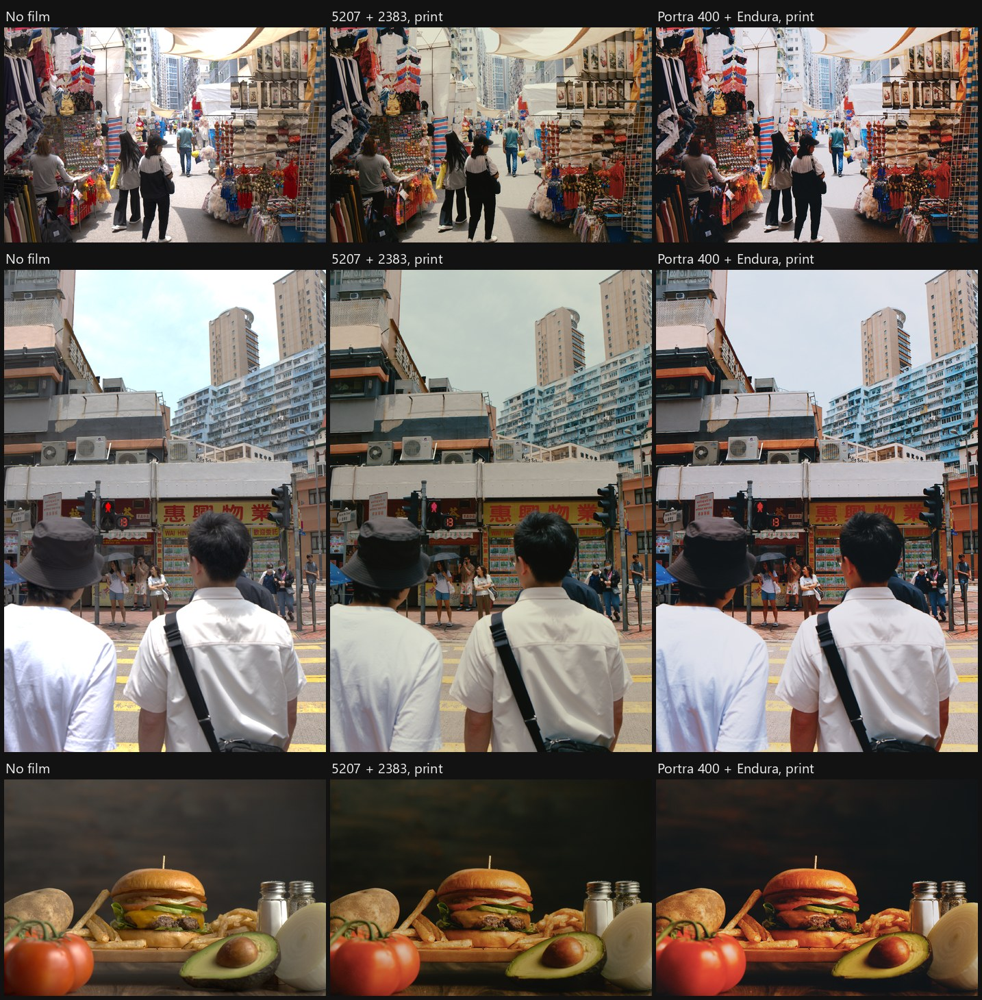

*Each row: the input with no film, Kodak VISION3 5207 printed on 2383, and Portra 400 printed on Endura Premier. Default values, but the first two photos have +3 EV in place of +1.5 EV, because they are underexposed. No grain. Photos: [credits](docs/images/CREDITS.md).*

## Features

- **30 colour negatives and 18 print materials**, including Kodak VISION3, Portra, Ektar, and Gold, and Fuji Eterna and Pro.
- **Two output methods:** a print on simulated paper or print film, and a scan with Academy Printing Density (APD) to ACES 2.0 or 1.3 output.
- **Scene light as a spectrum.** Choose daylight, tungsten, fluorescent, LED, sodium, or a mixture for night scenes. The choice changes what each film layer receives, so it is more than a white balance.
- **13 model controls:** overexposure, development inhibition, light spread, halation, lens flare, print contrast, paper flash, enlarger flare, and others.
- **RAW input** through LibRaw, at 2048 pixels on the long edge.
- **Usable speed on a CPU:** at 2048 pixels on an Intel Core i7-12700H, a render takes 1.91 s by the print and 2.98 s by the APD scan, with a loaded model. The first use of a negative and print pair builds its table and model in about 1 s, and a new value of a print control takes about 0.3 s.

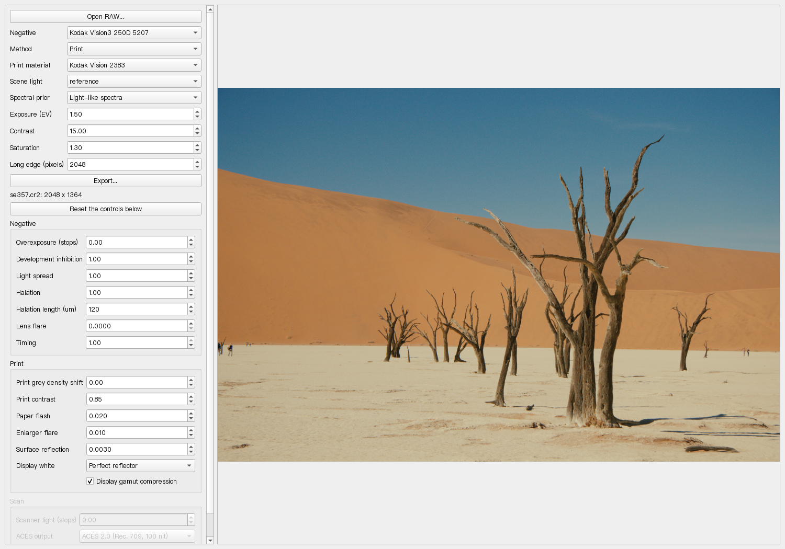

## Quick start

This is research code. These exact steps have not run on a clean clone. See [the program notes](scripts/poc/p6_mvp_gui/README.md).

```bash
E=build/tmp/p6
python -m venv $E/venv
$E/venv/Scripts/python -m pip install -r scripts/poc/p6_mvp_gui/requirements.txt
P=$E/venv/Scripts/python
D=scripts/poc/p6_mvp_gui
$P -I scripts/poc/p0_data_and_reference/fetch_sources.py
$P -I scripts/poc/p1_spectral_input/fetch_sources.py
$P -I scripts/poc/p3_scan_and_scene/fetch_sources.py

$P $D/p6_mvp_cli.py --list                 # negatives and print materials
$P $D/p6_mvp_gui.py INPUT.ARW              # the window
$P $D/p6_mvp_cli.py INPUT.ARW result.tif --negative kodak_portra_400 --method print --print-material kodak_endura_premier
$P $D/p6_mvp_cli.py INPUT.ARW result.tif --negative kodak_5207 --method apd --apd-output aces20
```

## How the algorithm works

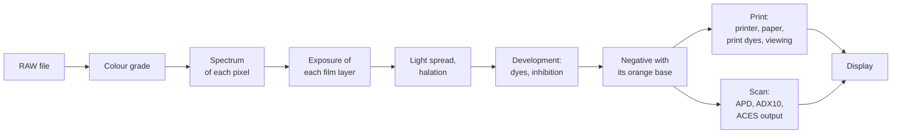

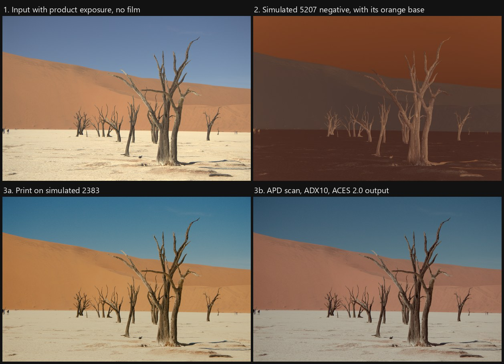

### 1. Input

LibRaw decodes the file with the camera white balance. The image goes to linear ACES AP1. The default colour grade of Alcedo Studio then applies: exposure +1.5 EV, contrast 15, and saturation 1.3, because the module receives the graded image in the product. The module does not know which camera made the file.

### 2. A spectrum for each pixel

Film layers do not see the same colours as the eye. The red layer of Portra 400 has its maximum at 651 nm and continues to 680 nm, where the eye has almost no weight. So RGB alone does not fix the film response, and the model must select a plausible spectrum.

The model makes a table over chromaticity (u', v'). Each node holds a smooth, non-negative spectrum, from a prior of measured reflectances. A pixel takes the shape at its chromaticity, scaled by its luminance:

```text
E(λ) = Y · ρ(u', v', λ) · L(λ)      L: the spectrum of the scene light
```

A reflectance prior gives a blue sky too much energy in the far red, because many blue objects reflect there, and sky light does not. So rule `light_like_spectra` changes the table in two sectors around the white, in the direction of skylight and of a low colour temperature light. There the shape becomes `exp(c0 + c1 x + c2 x²)`, and it keeps the XYZ of the node. A photo cannot separate an object from a light, so blue and orange objects pay a cost. The other prior stays as an option.

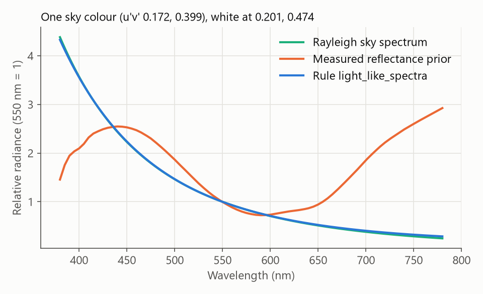

*One synthetic sky colour. The rule uses a family of smooth spectra that holds this shape, so the close match is expected. It is not a test on a measured sky.*

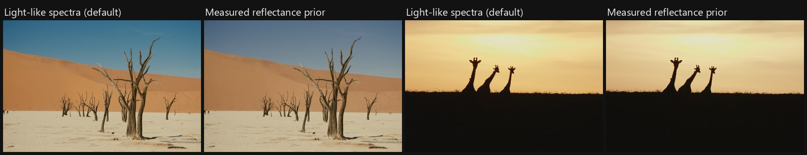

The scene light multiplies the shape. On a night scene, or under tungsten, each layer lands at a different place on its curve, as on real film.

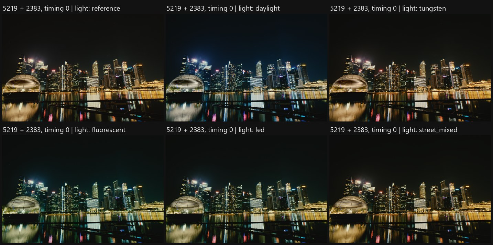

*5219 is a tungsten stock. With the timing control at 0, the printer lights do not correct the light, so the stock shows its balance: daylight turns blue, and fluorescent turns green. The default timing of 1 removes the cast at mid grey, and on this frame only a small difference between the lights stays.*

### 3. Exposure of each layer

Each layer integrates the spectrum through its published sensitivity:

```text
H_i = ∫ E(λ) S_i(λ) dλ      i = red, green, blue layer
```

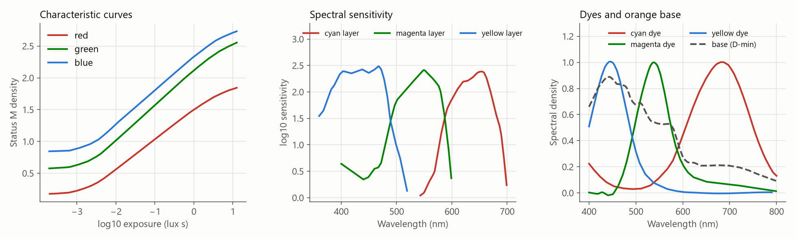

*The data of 5207 in this model: curves, sensitivities, dyes, and the orange base.*

### 4. Light inside the film

These steps act on the image, in micrometres on the film:

- **Light spread per layer.** An exponential spread with a length from the published modulation transfer curves: on 5207, about 5 um in the red layer and about 3 um in the green and blue layers.
- **Halation.** Light returns from the film base, and reaches the red layer first: a Gaussian of 120 um, with strength 0.03, 0.008, and 0.

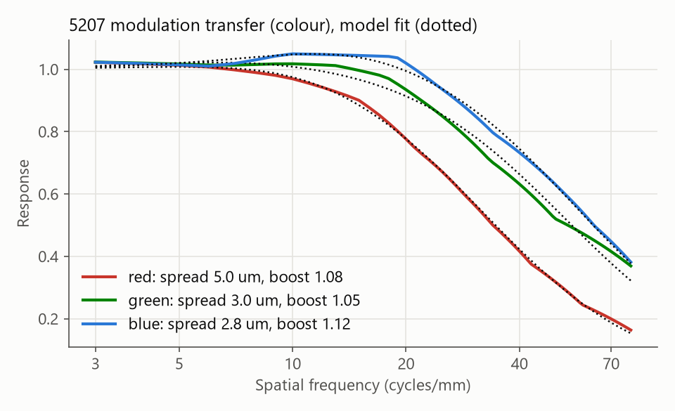

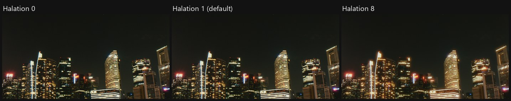

### 5. Development

A published curve is a density reading of a neutral grey. It is not the response of one layer. So the model solves the dye amounts on the neutral ramp once. This gives a curve from log exposure to the amount of the dye of that layer. A colour then keeps the side absorption of its dyes.

A developing layer also releases an inhibitor, which lowers development in that layer and in the others:

```text
a_i = F_i( log H_i − Σ_j K_ij (G * a_j) )
```

`G` is a Gaussian in the image plane. `F_i` is calculated so that a neutral returns the published curve. So a neutral and a large flat area keep their published tone, and a colour gets more separation, because its layers inhibit each other less. The total of `K` per layer comes from the modulation transfer curves. The split between layers has no published source, and is inferred.

The result is the spectral density of the negative, with its orange base:

```text
D(λ) = D_min(λ) + Σ_k a_k ε_k(λ)
```

### 6a. Output by the print

This is a calculation of a darkroom print:

1. **Enlarger.** Stray light of the lens veils the dense areas of the negative.
2. **Paper exposure.** The lamp passes through `D(λ)`, and the paper layers integrate it.
3. **Printer balance and grade.** The exposure is scaled about the grey: `log H' = aim + contrast · gain · (log H − aim)`. The gain gives each paper layer the same slope on a neutral. The contrast is 0.85 by default.
4. **Flash.** A small uniform exposure, 2 % of the exposure at the grey, softens the print.
5. **Paper curve and print dyes.** The curve gives Status A density, and a dye solve gives the spectral density of the print.
6. **Viewing.** A viewing light goes through the print dyes to XYZ, and a small surface reflection is added. The display white is a perfect reflector, so paper white stays below display white.
7. **Display.** A gamut compression, in the style of the ACES Reference Gamut Compression, acts on linear Rec. 709. Then sRGB encoding.

Steps 2 to 6 have no dependence on the image position, so they compile to a table over negative density. This is why the print is fast. The table comes from the spectral calculation in stages, so a new material builds new stages, and a new value of a print control only composes them again.

### 6b. Output by the APD scan

This path follows the published standards:

1. **APD.** ST 2065-2 reads the negative density.
2. **ADX10.** ST 2065-3 encodes it.
3. **Mid grey.** One offset per channel puts a neutral at code value 445. The next step assumes this grey. With no offset, the shadows of a tungsten stock turn blue.
4. **ACES.** The ADX10 to ACES transform of aces-dev v1.3.1.
5. **Output.** The ACES 2.0 transform for Rec. 709 at 100 nit by default, or ACES 1.3.

The scan is darker and has less colour than the print, because this transform holds no print stock. The control for scanner light moves the exposure.

## Stocks

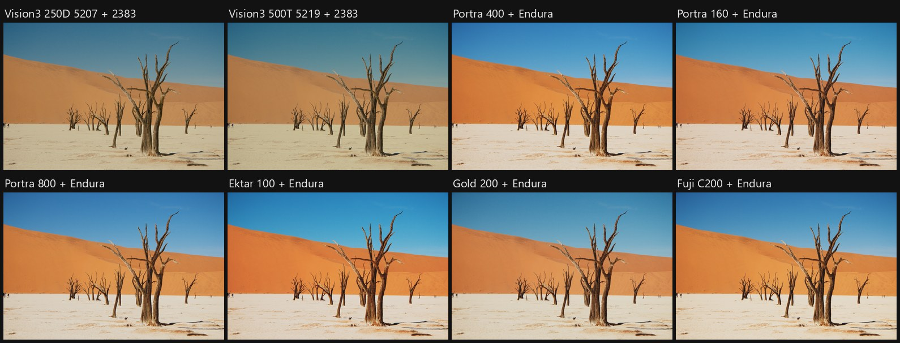

*Eight stocks on their default print. A colour cast is a part of the character of a stock, and the model keeps it. The owner of the project reviewed mainly 5207, 5219, and Portra 400. The look of most other stocks has no review.*

## Controls

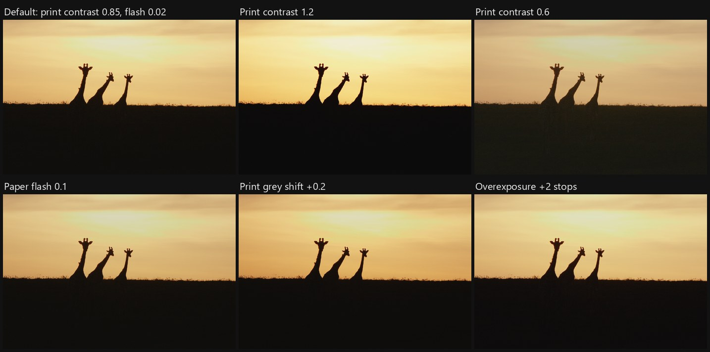

Negative: overexposure, development inhibition, light spread, halation amount and length, lens flare, timing. Print: grey shift, contrast, paper flash, enlarger flare, surface reflection, display white, gamut compression. Scan: scanner light, grey offset on or off, and ACES output. Their ranges are choices of the author, not measurements. `p6_mvp_cli.py --help` lists them.

## Difference from spektrafilm

[spektrafilm](https://github.com/andreavolpato/spektrafilm) by Andrea Volpato is an open spectral film simulation, and it is the visual comparison of this project. It is a complete tool, with a GUI, a LUT creator, grain, and slide stocks. The goal here is different: a module that will run on the GPU inside a RAW editor.

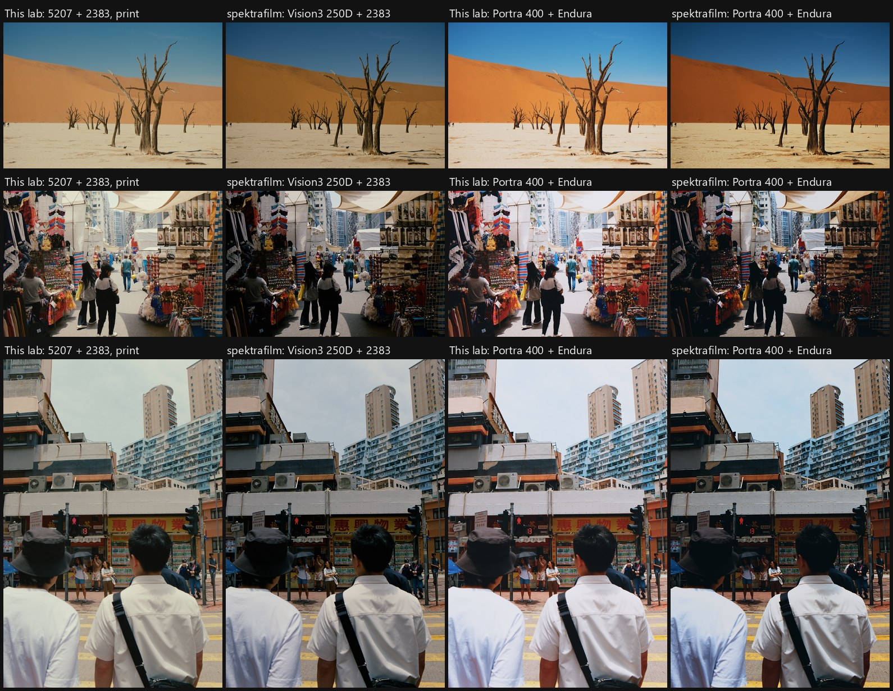

*Both with default values and no grain, from the same decoded RAW file, at spektrafilm `3bb2c2d2`. The exposure differs: this project uses the product grade (+1.5 EV on the first row, +3 EV on the two Hong Kong photos), and spektrafilm uses its own automatic exposure with no product grade. So a difference in brightness or saturation can come from the input and not from the film model. The profile of spektrafilm for 5207 has the name `kodak_vision3_250d`.*

| Item | This project | spektrafilm (code at `3bb2c2d2`) |
| --- | --- | --- |
| Goal | Film DRT for Alcedo Studio; GPU on CUDA, Metal, and OpenCL is planned | Python tool with a GUI and a LUT creator |
| Input | The image after the default product grade | The image of the user, with automatic exposure as an option |
| Spectrum from RGB | Measured reflectance prior on a u'v' table, and `light_like_spectra` | Hanatos 2025 LUT on xy |
| Scene light | A spectrum or a mixture that the user selects | The reference illuminant of each profile |
| Stock data | Kodak vector charts and spectral_film_lut; 30 negatives, 18 prints | Its own profiles; 28, with slide stocks |
| Negative | Solve for dye amounts | Channel density times CMY |
| Inhibition | Same first step; then 4 steps, with `K` fitted from modulation transfer | One step, with a hand matrix and an exponential tail |
| Light spread | Exponential per layer, fitted from modulation transfer | Gaussian core and exponential tail, default values |
| Halation | One Gaussian, 120 um | Three bounces, 65 um |
| Print balance | Status A aim, neutral gain, flash, contrast | Enlarger CC filters, mid grey by geometric mean |
| Scan | APD, ADX10, ACES output | `scan_film` |
| Display | Compression in the style of ACES RGC | Perceptual `compress_rgb` |
| Grain | None here; the product has its own | Full grain model |
| Sharpening | No unsharp mask by default | Unsharp mask (0.7, 0.7), glare 3 % |

**What this project owes to spektrafilm.** An audit ([report](docs/exploration/p6_python_mvp.md#52-links-of-p6-to-spektrafilm)) found no import, no copied code, and no copied profile value. But these items are not independent:

- The first step of `development_inhibition` is the same algorithm as its `model/couplers.py`.
- The cine print grey of 0.85 and the print contrast of 0.85 were selected by comparison with its output.
- The display white was selected after a comparison through both chains.

The chain from spectrum to negative to print is a concept that both projects share.

## Limits

- **The look evidence is the judgement of one person.** The owner ran the program on their own photos, and judged the look very good. There is no measured reference for most stocks, so this project makes no claim that it is the best or the most accurate. The only real film in the work is one set of 5207 strips, and only one scene has a digital pair.
- **Dirty backlit shadows** remain, and spektrafilm has them too. This is the best place to [contribute](CONTRIBUTING.md).
- **Few pairs have checks.** One print per negative and one negative per print ran, not all 540 pairs. The APD method has less testing than the print: its checks ran on 5207, and 22 negatives have no check on this method.
- **Inferred data.** Most stocks have an inferred dye split, and the negative density above 700 nm is an extrapolation.
- **No black and white or reversal stocks.**
- **CPU only.** The GPU work is not started.
- **A legal review is open.** The APD responsivities are SMPTE copyright, and the license in their archive covers XML schemas only. The product must not include that table before a review.

## More

- [ROADMAP.md](ROADMAP.md): the requirements, every decision, and the route to the product.
- [docs/exploration/](docs/exploration/README.md): the reports of all experiments, with their measurements and failures.

## Credits and licenses

Code and documents: [GPL-3.0](LICENSE). Data sources and their terms: [THIRD_PARTY_NOTICES.md](THIRD_PARTY_NOTICES.md). Main sources: spectral_film_lut (MIT), Kodak data sheets (not distributed), aces-dev, and ISSA reflectance data.

The photos are not under GPL-3.0. See [docs/images/CREDITS.md](docs/images/CREDITS.md).

Kodak, Vision3, Portra, Ektar, Gold, Endura, Fujifilm, and Eterna are trademarks of their owners. This project has no link with these companies, and no endorsement from them.
